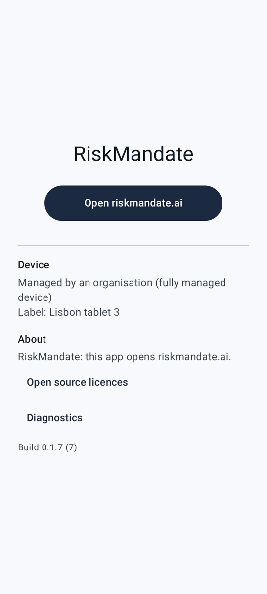

# Sample article

This is a **sample** that shows what a release article looks like. It is not a real release: the editor's first article replaces it.

## What an article can hold

- Headings, paragraphs and lists like this one.
- **Bold**, *italic* and `code` in the text.
- Links to riskmandate.ai, such as [RiskMandate](https://riskmandate.ai/). Any other link is shown as plain text and never opens.
- Screenshots of the new screens, taken by the build itself.

## A screenshot

## How to read it

1. Open What's new from the home screen.
2. Pick a release in the list.
3. On a tablet turned sideways the list and the article sit side by side.
