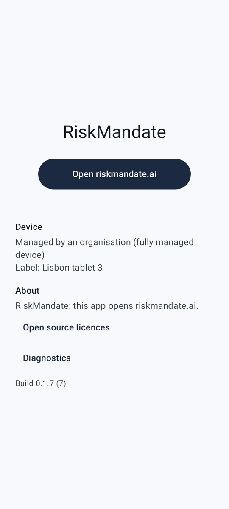

# Artigo de exemplo

Isto é um **exemplo** que mostra o aspeto de um artigo de versão. Não é uma versão real: o primeiro artigo do editor substitui-o.

## O que um artigo pode ter

- Títulos, parágrafos e listas como esta.
- **Negrito**, *itálico* e `código` no texto.
- Ligações para riskmandate.ai, como [RiskMandate](https://riskmandate.ai/). Qualquer outra ligação aparece como texto simples e nunca abre.
- Capturas de ecrã dos novos ecrãs, tiradas pela própria compilação.

## Uma captura de ecrã

## Como ler

1. Abra Novidades no ecrã inicial.
2. Escolha uma versão na lista.
3. Num tablet na horizontal, a lista e o artigo ficam lado a lado.
